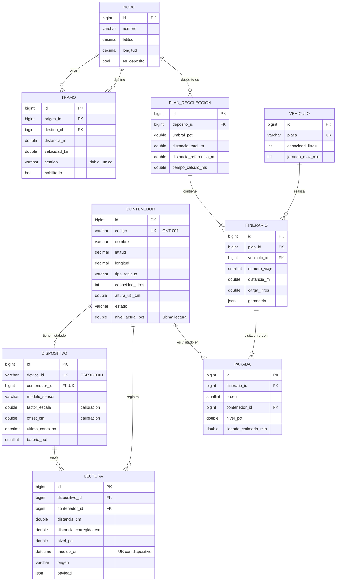

# 🗄️ Base de datos (ECO-2 · T-101 y ECO-9 · T-201)

| Archivo | Contenido |
|---|---|
| `schema.sql` | Script DDL para **MySQL 8**: tablas, claves, índices, restricciones y vistas |

> Las tablas las crea Django con `python manage.py migrate` (usa SQLite por defecto o MySQL
> si `DB_ENGINE=mysql` en el `.env`). `schema.sql` documenta el mismo diseño y permite crear
> la base sin Django.

## Diagrama entidad-relación



## Decisiones de diseño

- **`nivel_actual_pct` desnormalizado en el contenedor.** El dashboard y el algoritmo de rutas
  consultan el nivel de todos los contenedores constantemente. Guardar una copia de la última
  lectura evita buscarla cada vez en una tabla de millones de filas. El worker la actualiza
  en la misma transacción en la que inserta la lectura.
- **Unicidad `(dispositivo_id, medido_en)` en lecturas.** MQTT con QoS 1 puede entregar un
  mensaje más de una vez; esta restricción hace que el reenvío no duplique datos.
- **Índice `(contenedor_id, medido_en DESC)`.** Hace rápida la consulta del historial de un
  contenedor ordenado del más reciente al más antiguo (gráficos del Frontend).
- **Dispositivo separado del contenedor (relación 1 a 0..1).** Un sensor se puede cambiar
  de contenedor o reemplazar sin perder el historial, porque cada lectura guarda ambos IDs.
- **Calibración en la base de datos y no en el firmware.** El factor y el offset de cada
  sensor se ajustan desde la plataforma sin reprogramar el equipo (ECO-8).
- **Grafo vial dirigido.** Un tramo de `sentido = 'unico'` sólo se recorre de origen a destino.
  Así el algoritmo de rutas respeta los sentidos de circulación (ECO-9).
- **`payload` JSON en cada lectura.** Guarda el mensaje original para auditoría y depuración.
- **Fechas en UTC.** Se convierten a la hora de Lima (UTC−5) al mostrarlas.

## Crear la base en MySQL

```bash
# Opción A: con Docker (desde la raíz del repo)
docker compose --profile mysql up -d mysql

# Opción B: MySQL instalado en la PC
mysql -u root -p < DataBase/schema.sql
```

Luego, en `Backend/.env`:

```env
DB_ENGINE=mysql
DB_NAME=ecohuanuco
DB_USER=ecohuanuco
DB_PASSWORD=ecohuanuco
DB_HOST=127.0.0.1
DB_PORT=3306
```

E instale el driver: `pip install -r requirements-mysql.txt`. Después, `python manage.py migrate`.

> Si ya creó las tablas con `schema.sql`, ejecute `python manage.py migrate --fake-initial`
> para que Django las reconozca sin intentar crearlas de nuevo.
