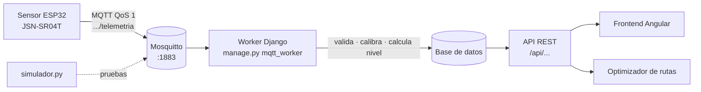

# 📡 IoT · EcoHuánuco AI

| Carpeta | Tarea | Contenido |
|---|---|---|
| `broker/` | ECO-5 · T-104 | Configuración de Mosquitto (desarrollo y producción), ACL y [contrato de tópicos](broker/TOPICOS.md) |
| `firmware/` | ECO-5 / ECO-8 | Firmware del sensor ESP32 + JSN-SR04T ([guía](firmware/README.md)) |
| `simulador/` | ECO-5 / ECO-6 | Simula los sensores para probar sin hardware |
| `calibracion/` | ECO-8 · T-107 | [Protocolo de calibración](calibracion/PROTOCOLO_CALIBRACION.md) y script de análisis |

## Flujo de datos



## Prueba completa en 4 terminales

```bash
# 1. Broker MQTT (requiere Docker Desktop)
docker compose up -d mosquitto

# 2. Backend (otra terminal, dentro de Backend/ con el venv activo)
python manage.py runserver

# 3. Worker de telemetría (otra terminal, dentro de Backend/)
python manage.py mqtt_worker

# 4. Simulador de 20 sensores (otra terminal)
python iot/simulador/simulador.py --intervalo 3
```

Abra http://localhost:8000/admin/monitoreo/lectura/ y verá llegar las lecturas.

### Sin Docker

- **Windows:** instale Mosquitto desde https://mosquitto.org/download/ y ejecútelo con
  `"C:\Program Files\mosquitto\mosquitto.exe" -c iot\broker\mosquitto.conf -v`.
  Antes, cambie `persistence_location` por una carpeta de Windows (por ejemplo `C:/mosquitto/data/`).
- **Sin broker:** el simulador también puede enviar por HTTP directo a la API:
  `python iot/simulador/simulador.py --http http://localhost:8000`.
